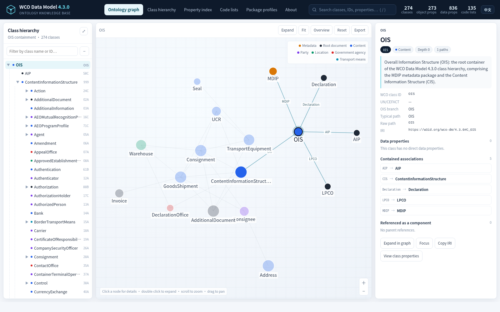

# WCO Data Model 4.3.0 — Ontology Knowledge Base

简体中文说明：[README.zh-CN.md](README.zh-CN.md) · [中文页面](https://yaoyaotaba.github.io/wco-dm-4.3.0-ontology/)

[](https://yaoyaotaba.github.io/wco-dm-4.3.0-ontology/)
[](ontology/wco-dm-4.3.0.ttl)
[](ontology/wco-dm-4.3.0-shapes.ttl)
[](ontology/wco-dm-4.3.0.ttl)

A derived **OWL 2 DL ontology + SKOS code lists + SHACL shapes + package profiles + interactive explorer** built from the official [WCO Data Model 4.3.0](https://datamodel.wcoomd.org/) LIB (element library) and OIS (Overall Information Structure) workbooks.

> **This is a derived work.** It is **not an official WCO publication** and does not imply WCO endorsement. WCO source data remains subject to WCO terms of use — see [NOTICE.md](NOTICE.md).



---

## Live explorer

| Page | URL |
|---|---|
| Site root (简体中文) | <https://yaoyaotaba.github.io/wco-dm-4.3.0-ontology/> |
| English | <https://yaoyaotaba.github.io/wco-dm-4.3.0-ontology/index-en.html> |
| 简体中文 (explicit) | <https://yaoyaotaba.github.io/wco-dm-4.3.0-ontology/index.html> |
| `/site/` copy (zh / en) | <https://yaoyaotaba.github.io/wco-dm-4.3.0-ontology/site/index.html> · [index-en.html](https://yaoyaotaba.github.io/wco-dm-4.3.0-ontology/site/index-en.html) |

The header **EN / 中文** switch swaps language and keeps the current view and selected class (for example `#/profiles`). Both pages are fully static: no CDN, no external fonts, all graph data is inlined in `assets/data.js`.

---

## What is inside

| Artefact | Content |
|---|---:|
| OWL classes | **274** |
| Object properties (OIS containment roles) | **273** |
| Datatype properties (global data elements) | **836** |
| Class-level containments (deduplicated) | **921** |
| `(class, data element)` usages | **1,188** |
| SKOS concept schemes | **135** |
| SKOS concepts (published code values only) | **69** |
| RDF triples (Turtle / RDF/XML / JSON-LD) | **26,663** |
| Core SHACL (NodeShape / PropertyShape / triples) | 274 / 2,109 / **18,459** |
| Profile packages / profile classes / elements / associations / flags | 4 / 387 / 1,541 / 1,077 / 37 |
| Profile graph triples | **25,407** |
| Profile SHACL triples | **14,248** |

### Top-level structure

```text
OIS  (Overall Information Structure)
├── MDIP   metadata information package
├── CIS    Content Information Structure
│   ├── Consignment / GoodsShipment / Party / Address / …
│   └── … 264 content classes
├── Declaration  42A   (LIB-only root document, inferred placement)
├── AIP          58C   (LIB-only root document, inferred placement)
└── LPCO         74B   (LIB-only root document, inferred placement)
```

---

## Quick start

### 1. Browse the static page

```bash
python3 -m http.server 8765          # serve the repository root
# then open http://127.0.0.1:8765/index.html  (zh) or /index-en.html (en)
```

The repository root and `site/` mirror each other so that linking works both on GitHub Pages (`/`) and when browsing the `site/` folder locally. Root pages use `assets/`; the `site/` copies use `site/assets/` and `../ontology/…` download links.

### 2. Open the ontology in Protégé

Open `ontology/wco-dm-4.3.0.ttl` or `ontology/wco-dm-4.3.0.owl`. Default namespace:

```text
https://w3id.org/wco-dm/4.3.0#
```

> This IRI base is a locally proposed persistent identifier scheme, **not** an official WCO resolution endpoint.

### 3. Validate a WCO DM instance

```bash
# core shapes
shacl validate --shapes ontology/wco-dm-4.3.0-shapes.ttl --data ontology/wco-dm-4.3.0-sample.ttl
# package-specific shapes (instance typed as a profile class)
shacl validate --shapes ontology/wco-dm-4.3.0-profiles-shapes.ttl --data ontology/wco-dm-4.3.0-profiles-sample.ttl
```

---

## Repository layout

| Path | Purpose |
|---|---|
| `index.html`, `index-en.html`, `assets/` | GitHub Pages entry points (zh / en) and mirrored page assets |
| `site/` | Static explorer sources: `index.html` (zh), `index-en.html` (en), `assets/` |
| `ontology/` | Turtle (canonical), RDF/XML, JSON-LD, SHACL, profile layer, samples, DCAT/VoID catalogue, PROV-O provenance |
| `data/` | Normalised model (`model.json`), CSV tables, package audit, `profiles.json` |
| `docs/` | Validation report, Excel coverage audit, profile-layer guide, screenshots |
| `scripts/` | Reproducible build pipeline and publisher |
| `sources/` | Download manifest and package tree only — **raw WCO workbooks and XSD are not stored here** |

---

## Data sources

The ontology is built from the official WCO publication package:

- **WCO DM download page: <https://datamodel.wcoomd.org/>**
- Package page (4.3.0): <https://datamodel.wcoomd.org/#/package>
- Package file-tree API: `GET https://datamodel.wcoomd.org/datamodel/infopage/4.3.0`
- Static file prefix: `https://datamodel.wcoomd.org/webpage/4.3.0/…`

| Input | Use | SHA-256 (first 16) |
|---|---|---|
| `1.1 WCO DM LIB V4.3.0.xlsx` | class definitions, 835 data elements, formats, core types, code-list catalogue, UN/CEFACT superclass alignment | `026a335f18426fff` |
| `WCO DM OIS_V4.3.0.xlsx` | 1,993 class occurrences, 7,810 attribute occurrences, containment hierarchy | `4f69b7d810f78191` |
| `package-tree.json` | snapshot of the package file tree | `01a660d299ae24e0` |

> **This public repository does not bundle the WCO raw files.** To rebuild, download them first (the script also copies the two core workbooks into `sources/xlsx/`), then run the full build:
>
> ```bash
> python3 scripts/fetch_sources.py
> python3 scripts/build_all.py
> ```

The Excel coverage audit covers **7 workbooks and 11 sheets**: the 4 core sheets (LIB DataSet 1.2/1.3/1.4, 1.5, 1.6 and the OIS sheet) are fully parsed; the 4 package sheets (MDIP, AIP, BIP DEC, BIP LPCO — 10,334 rows) are audited and their Min/Max are ingested; the 3 change-log sheets are archived only. Details: [docs/excel-coverage.md](docs/excel-coverage.md).

---

## Modelling decisions

1. **Global classes.** Each WCO Class ID becomes exactly one `owl:Class` (274), all subclasses of `wco:DataModelComponent`. The OIS hierarchy is containment, not taxonomy, so it is represented with object properties rather than `rdfs:subClassOf`.
2. **Object properties per role.** Each OIS role becomes one `owl:ObjectProperty` (273). `rdfs:range` is the unique target class; `rdfs:domain` is the `owl:unionOf` of all using parents (up to 87). Every role is a sub-property of `wco:hasComponent`.
3. **Global data elements.** Each `Attr. ID` becomes one `owl:DatatypeProperty` (836), merged across classes because LIB definitions and formats are consistent. `wco:usedByClass` keeps the full usage list.
4. **Cardinality.** All 8,212 data-element rows in the package workbooks have `Min=0`, `Max=1`. This is written as `wco:minOccurs` / `wco:maxOccurs` and SHACL `sh:maxCount 1`. Object-role maxima vary per package and are **not** asserted globally.
5. **Code lists.** 135 SKOS concept schemes; named `skos:Concept` only where LIB publishes values (12 lists, 69 values). No meanings are invented.
6. **LIB-only content.** `42A Declaration`, `58C AIP`, `74B LPCO` are added as root documents under OIS and flagged `wco:inferredPlacement true`; `599 Net weight` is added from LIB.
7. **Profile layer.** Package configuration is a separate graph: package classes are `owl:Class` subclasses of core classes (e.g. `prof:P_BIP_DEC_C_42A rdfs:subClassOf wco:C_42A`), package elements are `prof:ProfileProperty` individuals, and package SHACL only targets profile classes. See [docs/profile-layer.md](docs/profile-layer.md).

---

## Validation

```bash
npm install n3 rdfxml-streaming-parser jsonld rdf-validate-shacl
node scripts/validate-serializations.mjs
```

Current result: all three serialisations parse with **26,663** triples, reference integrity reports **0** missing IRIs, the conforming sample passes and the intentionally invalid sample fails as expected (core: `xsd:dateTime` violation; profile: `More than 1 values`). Full output: [docs/validation-report.md](docs/validation-report.md) and [docs/validation.json](docs/validation.json).

> OWL 2 DL reasoning (HermiT/ELK) has **not** been executed in this environment; run it in Protégé for a final consistency check.

---

## Licence and citation

- **WCO source data** — © World Customs Organization. Subject to WCO terms of use. Official WCO DM downloads: **<https://datamodel.wcoomd.org/>**
- **External code lists** — UN/EDIFACT, UN/CEFACT, ISO, IMO and others retain their own rights and conditions.
- **Derived ontology, profiles and pages in this repository** — provided “as is” for interoperability, teaching and analysis; not legal advice, no warranty.

If you cite the original data model, cite WCO (download: <https://datamodel.wcoomd.org/>):

```text
World Customs Organization. WCO Data Model, version 4.3.0.
https://datamodel.wcoomd.org/
```

If you cite this derived knowledge base:

```text
WCO Data Model 4.3.0 Ontology (derived knowledge base).
Built from the WCO DM 4.3.0 LIB and OIS workbooks.
https://w3id.org/wco-dm/4.3.0
```

See [NOTICE.md](NOTICE.md) for the full source and use notice.