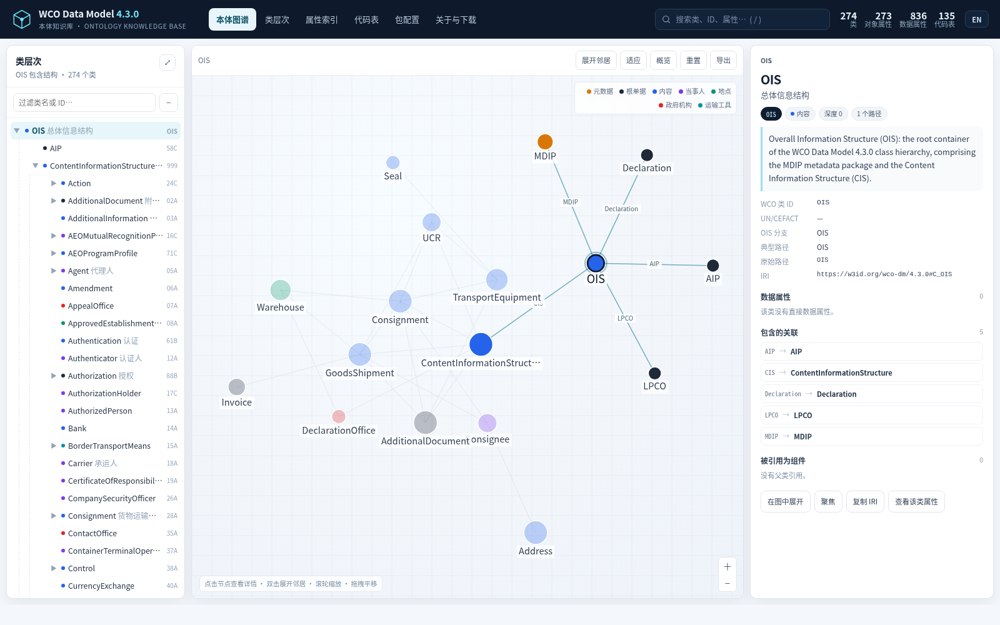
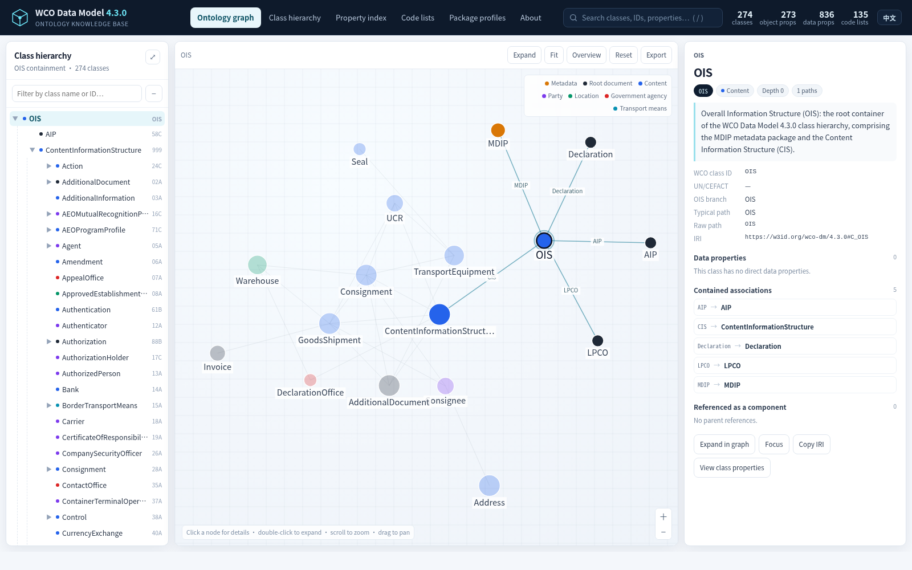
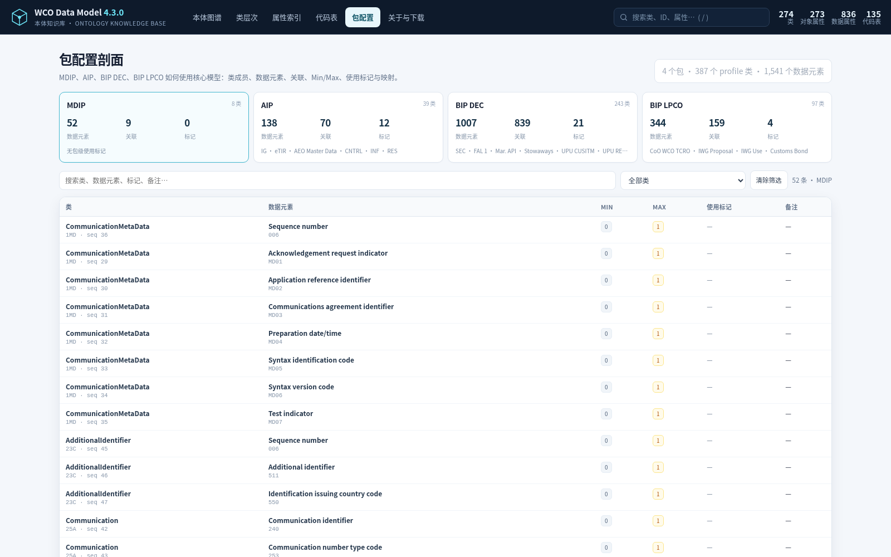

# WCO Data Model 4.3.0 本体知识库

English README：[README.md](README.md)

> 从世界海关组织（WCO）数据模型 4.3.0 官方发布包构建的 **OWL 2 DL 本体 + SKOS 代码表 + SHACL 形状 + 交互式可视化页面**。
>
> **本仓库是派生作品，不是 WCO 官方出版物，也不代表 WCO 认可。** WCO 源数据仍受其使用条款约束，详见 [NOTICE.md](NOTICE.md)。



---

## 快速开始

### 方式 1：直接打开静态页面

```bash
# 在项目根目录
open site/index.html          # macOS
xdg-open site/index.html      # Linux
# 或直接双击 site/index.html
```

页面完全离线可用，不依赖 CDN、字体或外部脚本。`site/assets/data.js` 内含全部图谱数据。

- 中文页面：`site/index.html`
- 全英文页面：`site/index-en.html`
- 仓库根目录的 `index.html` / `index-en.html` 是 Pages 入口（`assets/` 镜像 `site/assets/`）
- 页头右上角的 **EN / 中文** 开关可在两种语言间切换，并保留当前视图与选中类（如 `#/profiles`）。



### 方式 2：本地 HTTP 服务（推荐用于分享/演示）

```bash
# 在项目根目录启动，确保 ../ontology 下载链接可用
python3 -m http.server 8765
# 浏览器访问 http://127.0.0.1:8765/site/
```

### 方式 3：在 Protégé 中打开本体

打开 `ontology/wco-dm-4.3.0.ttl` 或 `ontology/wco-dm-4.3.0.owl`。默认命名空间：

```text
https://w3id.org/wco-dm/4.3.0#
```

> 该 IRI 基址是为本知识库拟定的持久标识方案，**不是 WCO 官方解析地址**。如需部署到正式域名，可整体替换命名空间后重新生成。

---

## 交付物

| 路径 | 内容 |
|---|---|
| `site/index.html` | 中文交互式主页：图谱、类层次、属性索引、代码表、包配置、关于与下载 |
| `site/index-en.html` | 全英文交互式主页；页头 **EN / 中文** 开关切换 |
| `site/assets/data.js` | 页面数据（类、关系、属性、代码表），约 0.7 MB |
| `site/assets/app.js` | 无依赖前端逻辑（Canvas 力导向图 + 树 + 表格） |
| `site/assets/style.css` | 响应式样式，适配桌面与移动端 |
| `ontology/wco-dm-4.3.0.ttl` | **规范序列化**：RDF 1.1 Turtle，26,663 三元组 |
| `ontology/wco-dm-4.3.0.owl` | RDF/XML 序列化，同一图，26,663 三元组 |
| `ontology/wco-dm-4.3.0.jsonld` | JSON-LD 1.1 序列化，同一图，26,663 三元组 |
| `ontology/wco-dm-4.3.0-shapes.ttl` | 核心 SHACL：274 个 NodeShape、2,109 个 PropertyShape、18,459 三元组 |
| `ontology/wco-dm-4.3.0-profiles.ttl` | 包配置 profile 知识图谱：4 个包、387 个 profile 类、1,541 个数据元素、1,077 个关联、37 个标记，25,407 三元组 |
| `ontology/wco-dm-4.3.0-profiles-shapes.ttl` | profile 专属 SHACL：按包校验 Min/Max、数据类型与关联目标类 |
| `ontology/wco-dm-4.3.0-sample.ttl` | 符合形状的示例实例（GoodsShipment） |
| `ontology/wco-dm-4.3.0-sample-invalid.ttl` | 故意违反日期类型的实例，用于演示校验 |
| `ontology/catalog.ttl` | DCAT 3 / VoID 数据集目录 |
| `ontology/provenance.ttl` | PROV-O 来源、构建活动、SHA-256 校验和 |
| `data/model.json` | 规范化中间模型（构建脚本输入） |
| `data/classes.csv` | 274 个类的扁平表 |
| `data/object-properties.csv` | 273 个对象属性 |
| `data/data-properties.csv` | 836 个数据属性 |
| `data/code-lists.csv` | 135 个代码表 |
| `data/package-sheets.csv` | 7 个工作簿 / 11 个 sheet 的覆盖审计 |
| `data/package-cardinalities.csv` | 10,334 行包级类/属性明细与 Min/Max |
| `data/profiles.json` | 可视化页面使用的 4 个包配置数据 |
| `data/ois-paths.csv` | OIS 中 9,805 行的完整路径/属性出现表 |
| `sources/package/` | 从 WCO 发布包下载的 95 个文件（XLSX + XSD），约 18 MB |
| `sources/download-manifest.csv` | 下载清单：URL、字节数、SHA-256、状态 |
| `sources/package-tree.csv` | 发布包完整文件树（135 个文件、含未下载项及原因） |
| `docs/excel-coverage.md` | 逐 sheet 的 Excel 覆盖审计与结论 |
| `docs/profile-layer.md` | Profile 层建模、SPARQL 查询与 SHACL 校验说明 |
| `docs/validation-report.md` | 解析、引用完整性、SHACL 校验报告 |
| `scripts/` | 可复现构建脚本 |

---

## 数据来源

> **公开仓库不包含 WCO 原始发布包文件。** 为保证可复现构建，需要先运行 `python3 scripts/fetch_sources.py` 从 WCO 官方接口重新下载 LIB/OIS 工作簿与 XSD，然后执行 `python3 scripts/build_all.py`。原始文件的 URL、字节数与 SHA-256 见 `sources/download-manifest.csv`；核心工作簿校验和：LIB `026a335f…7d54`、OIS `4f69b7d8…d63a`。


- **WCO 数据模型官方下载地址：<https://datamodel.wcoomd.org/>**
- 发布包页面（4.3.0）：<https://datamodel.wcoomd.org/#/package>
- 文件树接口：`GET https://datamodel.wcoomd.org/datamodel/infopage/4.3.0`
- 静态文件前缀：`https://datamodel.wcoomd.org/webpage/4.3.0/…`

核心输入：

| 文件 | 用途 | SHA-256（前 16 位） |
|---|---|---|
| `1.1 WCO DM LIB V4.3.0.xlsx` | 类定义、835 个数据元素、格式、核心类型、代码表目录、UN/CEFACT 超类对齐 | `026a335f18426fff` |
| `WCO DM OIS_V4.3.0.xlsx` | 1,993 个类出现位置、7,810 个属性出现位置、包含层次 | `4f69b7d810f78191` |
| `package-tree.json` | 发布包文件树快照 | `01a660d299ae24e0` |

同时下载了 MDIP、AIP、LPCO、Maritime API/BRI、UPU CUSITM/REFRSP、e-CO、CustomsBond 等 88 个 XSD 及其数据类型/代码表模块，用于交叉核对与后续实例校验。

> **Excel 覆盖说明**：7 个工作簿共 11 个 sheet。LIB 的 3 个 sheet 与 OIS 的 1 个 sheet 已全量解析；MDIP/AIP/BIP DEC/BIP LPCO 4 个包级 sheet 已审计并吸收 Min/Max；Changes 的 3 个 sheet 是变更日志，仅归档。逐 sheet 明细见 [docs/excel-coverage.md](docs/excel-coverage.md)。
>
> 两个 50 MB 级的合并模式（OIS、Declaration BIP）未纳入本地归档；其内容已由 OIS/LIB 工作簿与各 DIP 模式覆盖，详见 `sources/package-tree.csv` 的 `reason` 列。

---

## 知识库内容

| 指标 | 数值 | 说明 |
|---|---:|---|
| OWL 类 | **274** | 含 OIS 根、270 个 OIS/LIB 类、3 个 LIB 独有根单据 |
| 对象属性 | **273** | 270 个 OIS 包含角色 + 3 个推断根单据角色 |
| 数据类型属性 | **836** | 按 Attr. ID 合并的全局 WCO 数据元素 |
| 包含关系（类级） | **921** | OIS 去重后的 (父类, 角色, 子类) |
| 属性使用位置 | **1,188** | (类, 数据元素) 使用对 |
| 代码表 | **135** | SKOS ConceptScheme |
| 代码值 | **69** | 仅 LIB 明确列出的值 |
| RDF 三元组 | **26,663** | Turtle / RDF/XML / JSON-LD 一致 |
| SHACL | 274 NodeShape / 2,109 PropertyShape | 18,459 三元组 |

### 顶层结构

```text
OIS  (Overall Information Structure)
├── MDIP  元数据信息包
├── CIS   Content Information Structure
│   ├── DeclarationOffice / Consignment / GoodsShipment / Party / Address / …
│   └── … 264 个内容类
├── Declaration  42A   （LIB 独有，推断为根单据）
├── AIP          58C   （LIB 独有，推断为根单据）
└── LPCO         74B   （LIB 独有，推断为根单据）
```

### Profile 层：包配置知识图谱

核心本体之外，单独提供 `ontology/wco-dm-4.3.0-profiles.ttl`，把 4 个包“如何使用核心模型”形式化：

| 指标 | 数值 |
|---|---:|
| 包剖面 | 4（MDIP、AIP、BIP DEC、BIP LPCO） |
| profile 类（`owl:Class`，核心类的子类） | 387 |
| 包内数据元素（`prof:ProfileProperty`） | 1,541 |
| 包内关联（`prof:ProfileAssociation`） | 1,077 |
| 包级使用标记（`prof:Flag`） | 37 |
| profile 图三元组 | 25,407 |
| profile SHACL 三元组 | 14,248 |

示例：

```turtle
prof:PKG_BIP_DEC a prof:PackageProfile ;
  skos:prefLabel "BIP DEC" .

prof:P_BIP_DEC_C_42A a owl:Class ;
  rdfs:subClassOf wco:C_42A ;
  prof:inPackage prof:PKG_BIP_DEC .

prof:P_BIP_DEC_42A_D014 a prof:ProfileProperty ;
  prof:profile prof:PKG_BIP_DEC ;
  prof:ofClass prof:P_BIP_DEC_C_42A ;
  prof:ofProperty wco:dp_D014 ;
  prof:minOccurs 0 ;
  prof:maxOccurs 1 .
```

查询 BIP DEC 中 `Declaration` 的数据元素：

```sparql
PREFIX prof: <https://w3id.org/wco-dm/4.3.0/profile#>
PREFIX wco:  <https://w3id.org/wco-dm/4.3.0#>

SELECT ?prop ?min ?max WHERE {
  ?e a prof:ProfileProperty ;
     prof:profile prof:PKG_BIP_DEC ;
     prof:ofClass prof:P_BIP_DEC_C_42A ;
     prof:ofProperty ?prop ;
     prof:minOccurs ?min ;
     prof:maxOccurs ?max .
}
```



校验时，只需把实例声明为对应的 profile 类：

```turtle
ex:declaration a prof:P_BIP_DEC_C_42A ;
  wco:dp_D014 "DOC-001" .
```

然后用 `wco-dm-4.3.0-profiles-shapes.ttl` 校验；重复 `dp_D014` 会按 `Max=1` 报错。详见 [docs/profile-layer.md](docs/profile-layer.md)。

---

## 建模决策

### 1. 类：全局类，而不是按路径复制

OIS 中同一个类会在不同上下文中重复出现（例如 `Address` 出现于 87 个父类下）。本知识库为每个 **Class ID** 建立唯一的 `owl:Class`，共 274 个；所有类都是 `wco:DataModelComponent` 的子类。类之间的 OIS 层次不是分类学（`rdfs:subClassOf`），而是**包含/组合**，因此用对象属性表示。

### 2. 对象属性：按角色合并，域为并集

- 每个 OIS 角色（如 `GoodsShipment`、`Consignee`）一个 `owl:ObjectProperty`，共 273 个。
- `rdfs:range` 指向唯一目标类；`rdfs:domain` 为所有使用该角色的父类之并集（`owl:unionOf`），最多 87 个父类。
- 所有对象属性都是 `wco:hasComponent` 的子属性；`wco:isComponentOf` 是其逆属性。
- 同时用 `wco:usedByClass` 注解保留父类列表，便于不支持并集推理的查询。

### 3. 数据属性：按 Attr. ID 合并

- 每个 WCO 数据元素 ID（如 `D014`）一个 `owl:DatatypeProperty`，共 836 个。
- 同一 ID 在不同类中语义一致（LIB 中无冲突定义/格式），因此合并为全局属性；`wco:usedByClass` 记录所有使用类。
- `rdfs:range` 映射到 XSD 类型：`Code/Identifier/Text → xsd:string`、`Date Time → xsd:dateTime`、`Numeric/Quantity/Measure/Amount → xsd:decimal`、`Indicator → xsd:boolean`、`Binary Object → xsd:base64Binary`。
- 保留 `wco:format`、`wco:maxLength`、`wco:totalDigits`、`wco:fractionDigits`、`wco:coreDataType`、`wco:xmlTag`、`wco:jsonTag` 等原始 LIB 信息。

### 4. 代码表：只记录有依据的内容

- 135 个命名代码表 → 135 个 `skos:ConceptScheme`，保留 `dcterms:source` 原始来源。
- 仅当 LIB 明确给出代码值时才创建 `skos:Concept`（12 个表、69 个值）；没有描述时不编造含义。
- 属性上的 `wco:codeList` 保留原始来源字符串；仅当来源与某个命名表**唯一匹配**时才写 `wco:codeListName`，避免把 `UN/EDIFACT 7365` 这类多表共享来源错误绑定到单一表。

### 5. 补入 LIB 独有内容

OIS 未包含以下 LIB 条目，本知识库显式补入并标注：

- 类 `42A Declaration`、`58C AIP`、`74B LPCO`：作为 `OIS` 的根单据子类；`wco:inferredPlacement true`。
- 数据元素 `599 Net weight`（`65A GoodsMeasure`）：仅出现在 LIB，已补入并使用 `wco:usedByClass wco:C_65A`。

### 6. 基数：吸收包级工作簿的 Min/Max

OIS 本身不含消息级基数，但 4 个包级数据模型工作簿（MDIP、AIP、BIP DEC、BIP LPCO）提供了 `Min` / `Max` 列。审计结果：

- 4 个包级 sheet 共 10,334 行，其中 **8,212 个数据元素行全部 `Min=0`、`Max=1`**。
- 包级 sheet 中的类/属性 ID **全部已在核心 LIB/OIS 模型中**，0 个新 ID、0 个定义冲突。
- 因此数据属性写 `wco:minOccurs 0`、`wco:maxOccurs 1`，SHACL 写 `sh:maxCount 1`。
- 对象属性的 Max 在不同包中可能为 `unbounded` 或 `1`（例如 `60C`），所以对象属性只写 `wco:minOccurs 0`，不写全局 max。
- SHACL 仍为开放形状（`sh:closed false`），不强制可选属性必须出现。

---

## 标准符合性

| 标准 | 使用方式 |
|---|---|
| **OWL 2 DL** | `owl:Class`、`owl:ObjectProperty`、`owl:DatatypeProperty`、`rdfs:subClassOf`、`rdfs:domain/range`、`owl:unionOf`、`owl:inverseOf`、`rdfs:subPropertyOf`；无 OWL Full 构造 |
| **RDF 1.1** | Turtle 规范序列化；RDF/XML 与 JSON-LD 为等价序列化 |
| **SKOS** | `skos:ConceptScheme`、`skos:Concept`、`skos:prefLabel`、`skos:definition`、`skos:notation`、`skos:inScheme` |
| **SHACL** | `sh:NodeShape`、`sh:PropertyShape`、`sh:targetClass`、`sh:path`、`sh:datatype`、`sh:class`、`sh:nodeKind`、`sh:pattern`、`sh:maxLength`、`sh:maxCount` |
| **PROV-O** | 构建活动、软件代理、源文件、校验和 |
| **DCAT 3 / VoID** | 数据集目录、分布、三元组/类/属性计数 |
| **Dublin Core Terms** | 标题、描述、来源、权利、版本日期 |

外部词表（SKOS、DCTerms、PROV-O、VoID、DCAT）的术语在文件中**本地声明为注解属性或对象属性**，以保证单文件可离线解析；生产部署时可替换为 `owl:imports`。

---

## 校验

### 已执行

```bash
# 1) Turtle 解析（N3.js 1.17.2）
node -e 'const fs=require("fs"),N3=require("n3");const q=new N3.Parser().parse(fs.readFileSync("ontology/wco-dm-4.3.0.ttl","utf8"));console.log(q.length)'
# => 26663

# 2) RDF/XML 与 JSON-LD 解析，均为 26663 个四元组

# 3) SHACL：合规样例
# => conforms = true, results = 0

# 4) SHACL：故意违规样例
# => conforms = false, results = 1
#    "Value does not have datatype xsd:dateTime"
```

详细结果、输入校验和与已知限制见 [docs/validation-report.md](docs/validation-report.md)。

### 建议的进一步校验

- 在 Protégé 中运行 HermiT 或 ELK，检查 OWL 2 DL 一致性；本仓库未捆绑 Java 推理机。
- 用 Apache Jena `riot --validate` 或 RDF4J 再做一次语法与 profile 校验。
- 用 pySHACL 对真实报文实例做批量校验；当前仅提供两个最小样例。

---

## 复现构建

```bash
# 依赖：Python 3.8+（仅标准库）
python3 scripts/build_all.py
```

该脚本依次执行：

1. `wco_model.py`：解析 `sources/xlsx/*.xlsx`，生成 `data/model.json` 与 CSV。
2. `package_audit.py`：审计 4 个包级工作簿，生成 `data/package-sheets.csv` 与 `data/package-cardinalities.csv`。
3. `build_profiles.py`：生成 profile 知识图谱、profile SHACL 与样例。
4. `build_ontology.py`：生成核心 Turtle / RDF/XML / JSON-LD / SHACL / 样例 / 目录 / 来源。
5. `build_site_data.py`：生成 `site/assets/data.js` 与 `data.json`。

下载源文件：

```bash
python3 scripts/fetch_sources.py   # 读取 sources/package-tree.json，按清单下载
```

---

## 已知限制

1. **不是官方本体**：IRI 基址、类/属性命名与建模选择均为本仓库自行拟定，WCO 未参与或背书。
2. **OIS 不完整**：OIS 缺少 `Declaration`、`AIP`、`LPCO` 三个根单据类；本仓库将其推断挂在 `OIS` 下，可能与 WCO 内部结构不同。
3. **日期时间语义简化**：XML 使用 CCTS `DateTimeString + formatCode`；本体统一为 `xsd:dateTime`，不保留原始格式代码。
4. **代码表覆盖有限**：LIB 只给出 135 个表的目录，其中仅 12 个表列出具名代码值；UN/EDIFACT、ISO 等外部表的完整成员需从各自发布方获取。
5. **基数范围**：数据元素 `Min=0`、`Max=1` 已吸收；对象角色的最大值随包变化，未全局断言。SHACL 不强制可选属性出现。
6. **序列化等价性**：三种序列化的三元组数与谓词分布一致；空白节点标识不同，未做形式化同构证明。
7. **两个超大合并模式未归档**：OIS 与 Declaration BIP 的 50 MB 级 XSD 未下载；如需要，可按 `sources/package-tree.csv` 中的 URL 直接获取。
8. **包级配置未物化**：DIP 使用标记、Remark、IMO 映射、Cell Address 保留在 `data/package-cardinalities.csv`，未转成 OWL 公理。
9. **变更日志未摄取**：Changes 工作簿的 3 个 sheet 仅归档，不作为当前模型公理。
10. **Profile 覆盖范围**：profile 层已物化包成员、Min/Max、Seq、37 个使用标记、Remark、IMO 映射与 Cell/UPI；`MyDataSet` 扩展字段与原始批注未全部物化。

---

## 许可与引用

- **WCO 源数据**：版权归世界海关组织所有，使用受 WCO 条款约束。
  - WCO 数据模型官方下载地址：**<https://datamodel.wcoomd.org/>**
  - 4.3.0 发布包页面：<https://datamodel.wcoomd.org/#/package>
  - WCO 官网：<https://www.wcoomd.org/>
- **外部代码表**：UN/EDIFACT、UN/CEFACT、ISO、IMO 等各自保留权利。
- **本仓库的派生本体与页面**：为互操作、教学与分析目的提供，按“原样”提供，不构成法律意见，也不附任何明示或暗示担保。

引用原始数据模型时，请优先引用 WCO 官方版本（下载地址 <https://datamodel.wcoomd.org/>）：

```text
World Customs Organization. WCO Data Model, version 4.3.0.
https://datamodel.wcoomd.org/
```

引用本派生知识库时：

```text
WCO Data Model 4.3.0 Ontology (derived knowledge base).
Generated from the WCO DM 4.3.0 LIB and OIS workbooks, 2026-10-31.
https://w3id.org/wco-dm/4.3.0
```

---

## 目录结构

```text
wco-dm-4.3.0/
├── README.md
├── NOTICE.md
├── CITATION.cff
├── site/
│   ├── index.html
│   ├── index-en.html
│   └── assets/{app.js,style.css,data.js,data.json}
├── ontology/
│   ├── wco-dm-4.3.0.ttl
│   ├── wco-dm-4.3.0.owl
│   ├── wco-dm-4.3.0.jsonld
│   ├── wco-dm-4.3.0-shapes.ttl
│   ├── wco-dm-4.3.0-profiles.ttl
│   ├── wco-dm-4.3.0-profiles-shapes.ttl
│   ├── wco-dm-4.3.0-profiles-sample.ttl
│   ├── wco-dm-4.3.0-profiles-sample-invalid.ttl
│   ├── wco-dm-4.3.0-sample.ttl
│   ├── wco-dm-4.3.0-sample-invalid.ttl
│   ├── catalog.ttl
│   └── provenance.ttl
├── data/
│   ├── model.json
│   ├── classes.csv
│   ├── object-properties.csv
│   ├── data-properties.csv
│   ├── code-lists.csv
│   ├── ois-paths.csv
│   ├── package-sheets.csv
│   ├── package-cardinalities.csv
│   └── profiles.json
├── sources/
│   ├── xlsx/{wco_lib_430.xlsx,wco_ois_430.xlsx}
│   ├── package/…（95 个下载文件）
│   ├── package-tree.json / package-tree.csv
│   └── download-manifest.csv
├── docs/
│   ├── excel-coverage.md
│   ├── profile-layer.md
│   ├── validation-report.md
│   └── visualization.png
└── scripts/
    ├── fetch_sources.py
    ├── wco_model.py
    ├── package_audit.py
    ├── build_profiles.py
    ├── build_ontology.py
    ├── build_site_data.py
    └── build_all.py
```
